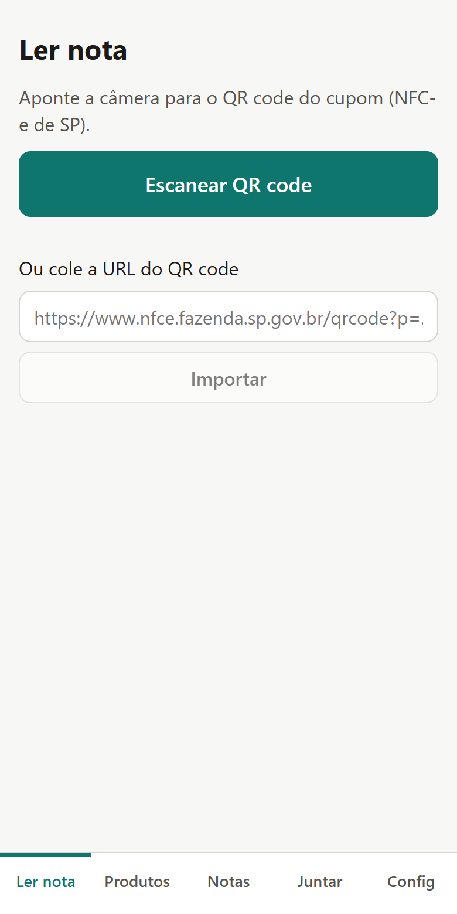
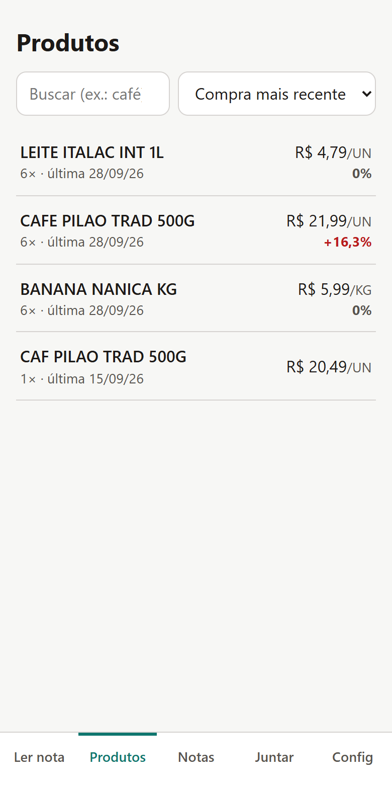
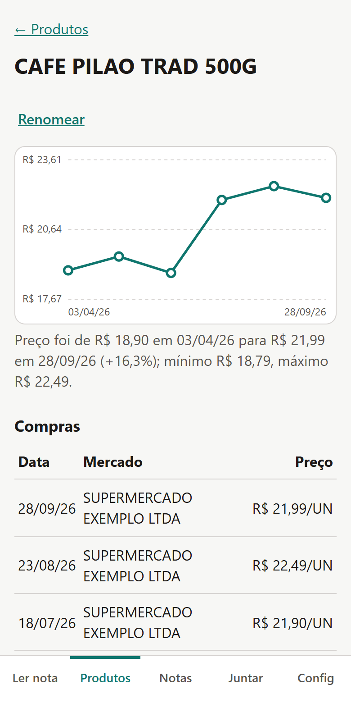
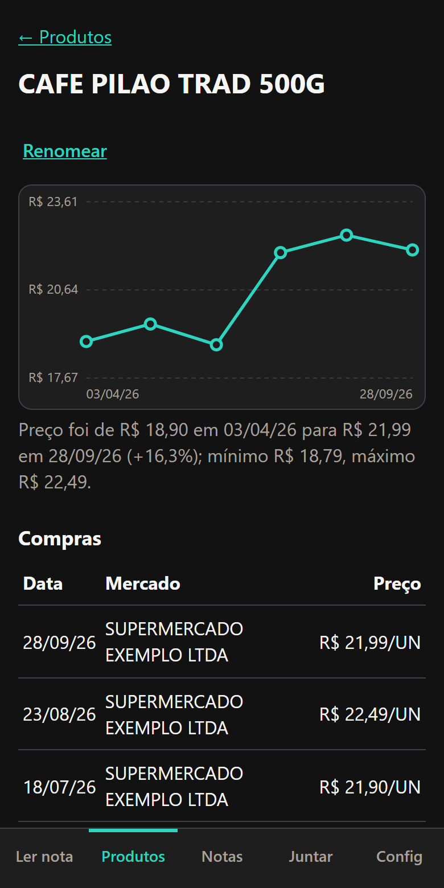
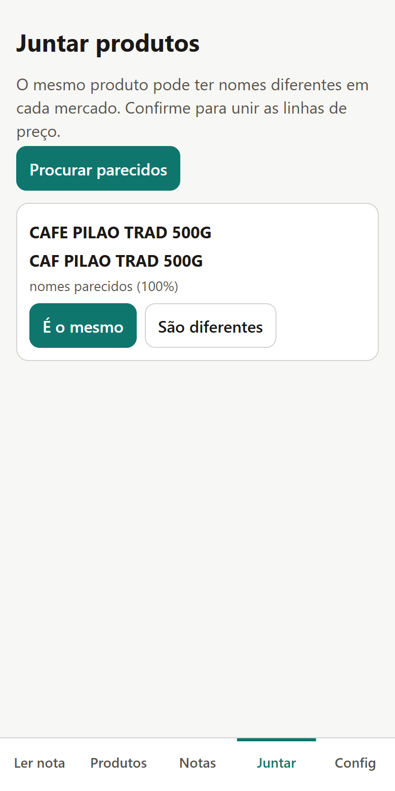
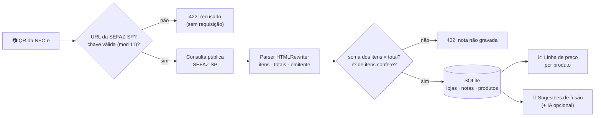

<div align="center">


# Preço Vivo

**Escaneie o QR code da nota do supermercado e veja o preço de cada produto evoluir ao longo do tempo.**

[](https://bun.sh)
[](https://hono.dev)
[](https://react.dev)
[](https://vite.dev)
[](https://bun.sh/docs/api/sqlite)
[](#-no-celular-pwa)
[](https://biomejs.dev)
[](LICENSE)

</div>

<p align="center">
  
  
  
  
  
</p>

---

## ✨ O que faz

- 📷 **Lê o QR code da NFC-e** pela câmera, ou pela URL colada, e importa todos os itens do cupom.
- 📈 **Linha de preço por produto**, com mínimo, máximo e variação desde a primeira compra.
- 🔎 **Ranking de "maior aumento"** para ver onde a inflação da sua cesta está batendo.
- 🧩 **Junta o mesmo produto entre mercados** (`CAFE 3 COR VAC 500G` ≈ `CAFE 3 CORAC 500 GR`): sugestão automática que você confirma, com IA opcional para filtrar os pares.
- 🔁 **Idempotente**: escanear a mesma nota de novo não duplica nada.
- 📱 **PWA instalável**, com modo escuro e leitor de QR que funciona offline (wasm local).

> Homologado contra a SEFAZ-SP real com **14 notas de 2020 a 2026**: supermercados, atacarejo, postos, papelaria e fast-food, nos formatos de QR v2 e v3.

## 🧠 Como funciona



- **Mesmo código no mesmo mercado = mesmo produto.** Entre mercados, os candidatos saem de tokens do nome, abreviações (`CAF` ≈ `CAFE`) e tamanho da embalagem normalizado (`1L` = `1000ML`). Números de modelo diferentes nunca viram par.
- **Falha alto, nunca pela metade**: se a SEFAZ mudar o layout ou devolver uma página de erro, a importação dá 422 e nada é gravado.

## 🚀 Começando

```bash
bun install
cp .env.example .env          # defina API_TOKEN (>= 24 caracteres)
bun run dev:server            # API em http://localhost:3000
bun run dev:web               # app em http://localhost:5173 (proxy /api -> :3000)
```

Abra o app, vá em **Config** e cole o `API_TOKEN`. Endereço vazio significa o mesmo host.

<details>
<summary><b>Variáveis de ambiente</b></summary>

| Variável | Padrão | Para quê |
|---|---|---|
| `API_TOKEN` | obrigatório | Token Bearer exigido em `/api/*` (mín. 24 caracteres) |
| `PORT` | `3000` | Porta HTTP |
| `DB_PATH` | `data/preco-vivo.db` | Arquivo SQLite (modo WAL) |
| `CORS_ORIGINS` | `http://localhost:5173,…` | Origens liberadas para chamar a API |
| `WEB_DIST` | vazio | Pasta do build do web para servir junto |
| `LLM_BASE_URL` / `LLM_API_KEY` / `LLM_MODEL` | vazio | Gateway compatível com OpenAI (ex.: LiteLLM) para filtrar sugestões |

</details>

## 🐳 Docker

```bash
docker build -t preco-vivo .
docker run -p 3000:3000 -e API_TOKEN=... -v preco-vivo-data:/data preco-vivo
```

Imagem de ~70 MB, roda como usuário não-root, tem `HEALTHCHECK` em `GET /health` e serve API e PWA no mesmo endereço. Faça backup do volume `/data`.

## 📱 No celular (PWA)

Publique atrás de **HTTPS**, porque a câmera só funciona em contexto seguro. Depois:

- **Android/Chrome**: menu → *Instalar app*
- **iOS/Safari**: Compartilhar → *Adicionar à Tela de Início*

O service worker guarda só o app. Respostas de `/api` nunca vão para o cache.

## 🔌 API

Todas as rotas `/api/*` exigem `Authorization: Bearer <API_TOKEN>`. As listas são paginadas (`limit` ≤ 100, `offset`).

| Método | Rota | Descrição |
|---|---|---|
| `POST` | `/api/receipts` | Importa `{ "url": "<URL do QR>" }` → `201` nova · `200` já existia |
| `GET` | `/api/receipts` | Notas importadas, da mais recente para a mais antiga |
| `GET` | `/api/products?q=&sort=recent\|variation\|name` | Produtos com primeiro/último preço, mínimo e máximo |
| `GET` | `/api/products/:id` | Detalhe com a série de preços e os nomes em cada cupom |
| `PATCH` | `/api/products/:id` | Renomeia `{ "name": "…" }` |
| `POST` | `/api/products/:id/merge` | Junta `{ "sourceIds": [..] }` neste produto |
| `POST` | `/api/suggestions/refresh` | Gera novas sugestões de fusão |
| `GET` | `/api/suggestions` | Sugestões pendentes |
| `POST` | `/api/suggestions/:id/accept` · `/dismiss` | Confirma ou descarta |
| `GET` | `/health` | Health check público |

## 🔒 Segurança e privacidade

- **Anti-SSRF**: só o host `nfce.fazenda.sp.gov.br` é aceito. A URL é reconstruída na forma canônica, redirects não são seguidos e a resposta tem teto de tamanho e de tempo.
- **CPF do consumidor**, quando aparece na página da SEFAZ, nunca é gravado nem logado (há teste para isso).
- Os nomes de produto vão para a IA **como dados, não como instrução**. A saída é validada por esquema, e você confirma toda fusão.
- Token comparado em tempo constante, queries parametrizadas, `ORDER BY` só a partir de uma lista fixa.

## 🧪 Qualidade

```bash
bun run test        # 36 testes: parser, SSRF, idempotência, concorrência, fusão
bun run typecheck   # tsc do servidor + build do web
bun run lint        # Biome (lint + format)
```

## 🗺️ Limitações e próximos passos

- [ ] Só **SP** por enquanto. O layout é compartilhado por outros estados, então dá para expandir a allowlist com homologação.
- [ ] Consultar **só pela chave** exige captcha na SEFAZ-SP, então a entrada é o QR ou a URL dele.
- [ ] A consulta pública **não traz EAN**; o agrupamento usa o código interno de cada mercado.
- [ ] Separar a linha de preço quando o mesmo código é vendido em unidades diferentes (ex.: `PC` × caixa `DP`).
- [ ] Um ponto por nota quando o mesmo produto aparece em várias linhas do cupom.
- [ ] Esconder o gráfico quando só existe uma compra.

## 📁 Estrutura

```
server/   Bun + Hono + bun:sqlite: nfce/ (url, fetch, parse), receipts/, products/, suggestions/
web/      Vite + React PWA: pages/, components/ (QrScanner, PriceChart), public/ (manifest, sw.js)
docs/     screenshots
```

## 📄 Licença

[MIT](LICENSE)
